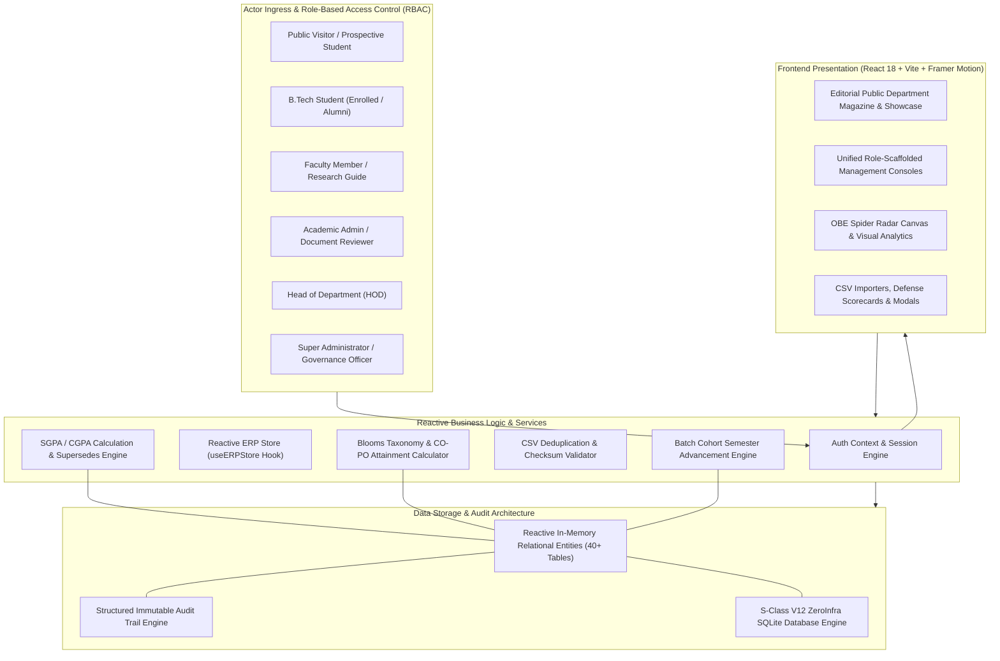
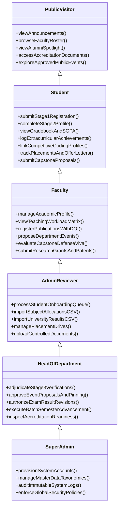

# Department Academic Portal & Enterprise Resource Planning (ERP)

[](https://www.typescriptlang.org/)
[](https://react.dev/)
[](https://vitejs.dev/)
[](src/tests/index.ts)
[](#system-architecture)
[](https://opensource.org/licenses/MIT)

A mission-critical, enterprise-grade **Academic ERP & Departmental Portal** engineered for the **Department of Computer Science & Engineering**. Built on **React 18**, **TypeScript**, and a reactive zero-infrastructure storage architecture, the system coordinates institutional workflows across 6 distinct actor roles, governs Outcome-Based Education (OBE), manages research grants, and automates undergraduate student lifecycles from initial onboarding to alumni spotlighting.

---

## 🏛️ System Architecture



---

## 🎭 6-Tier Role-Based Operational Matrix



---

## ⚡ Core Engineering Modules

### 1. Outcome-Based Education (OBE) & CO-PO Attainment
- Maps individual course outcomes (COs) to National Board of Accreditation Program Outcomes (PO1–PO12) and Program Specific Outcomes (PSO1–PSO2).
- Dynamically computes attainment levels across cognitive domains aligned with **Bloom's Revised Taxonomy** (Remember, Understand, Apply, Analyze, Evaluate, Create).
- Visualizes department-wide accreditation readiness through custom SVG Spider Radar Charts with overflow-safe dynamic geometry.

### 2. Capstone Thesis & Viva Defense Evaluation
- Manages the lifecycle of B.Tech capstone thesis projects from proposal defense to final prototype evaluation.
- Features multi-criteria viva scorecards (Phase 1, Phase 2, and Final Letter Grade `O`, `A+`, `A`, `B+`, `B`).
- Implements role-aware guide allocation filtering (`My Guided Projects` vs `All Department Capstones`).

### 3. Exam Result Supersedes Engine & Audit Tracking
- Supports multi-semester gradebook publishing with automatic computation of SGPA and cumulative CGPA.
- Incorporates university result revision workflows: re-evaluations create versioned records linked through a deterministic `supersedesResultId` chain without mutating historical audit records.

### 4. CSV Import Deduplication & Checksum Integrity
- Batch CSV imports for subject allocations and student results calculate MD5/SHA-256 content hashes to reject duplicate uploads (`DUPLICATE_IMPORT` exception).
- Automatically triggers section capacity alerts whenever enrolled counts exceed section quotas.

---

## 📂 Repository Directory Layout

```text
cse-dept-erp/
├── src/
│   ├── components/             # Reusable design system components
│   │   ├── navigation/         # Header, sidebar & breadcrumbs
│   │   ├── research/           # Publication & grant linkage visualizers
│   │   └── ui/                 # DataTable, StatusPill, PrimaryButton, VisualChart
│   ├── context/                # Authentication & actor session provider
│   ├── db/
│   │   ├── seed.ts             # Deterministic relational department seed dataset
│   │   └── store.ts            # Central reactive store & entity mutation APIs
│   ├── hooks/                  # Reactive store state subscriptions (useERPStore)
│   ├── pages/
│   │   ├── accreditation/      # OBE CO-PO spider charts & NAAC criteria matrices
│   │   ├── admin/              # Onboarding queue & university result importers
│   │   ├── capstone/           # Thesis guide allocation & viva defense scorecards
│   │   ├── events/             # Faculty proposal submissions & HOD review queue
│   │   ├── faculty/            # Teaching workload matrix & profile self-edit
│   │   ├── public/             # Editorial department magazine & alumni spotlight
│   │   ├── research/           # Scopus publications, DST grants & patent filings
│   │   └── student/            # Multi-stage onboarding, gradebook & achievements
│   ├── tests/
│   │   ├── index.ts            # 73-scenario opaque-box E2E test execution harness
│   │   └── suites/             # Tier 1-4 test definitions & lifecycle simulations
│   ├── types/
│   │   └── erp.ts              # Canonical domain entities, enums & relational models
│   └── utils/                  # Checksum hashing, grade point engines & formatters
├── CSE-Department-ERP-Master-Design-v4-Merged.md # Comprehensive specifications
├── DATABASE_SCHEMA.md          # Complete relational schema documentation
├── ROLE_INTERACTION_MATRIX.md  # Permitted actor transaction maps
├── vite.config.ts              # Vite bundling & development server settings
├── tsconfig.json               # Strict TypeScript compilation rules
└── package.json
```

---

## 🧪 Comprehensive Opaque-Box E2E Test Suite

The repository incorporates an automated 73-scenario test harness executed with zero external mock dependencies (`npx tsx src/tests/index.ts`):

```text
===============================================================
  CSE Department ERP - Opaque-Box E2E Test Execution Suite
===============================================================

▶ Suite: Tier 1: Student Role Feature Coverage (6/6 Passed)
▶ Suite: Tier 1: Faculty Role Feature Coverage (5/5 Passed)
▶ Suite: Tier 1: Admin/Reviewer Role Feature Coverage (5/5 Passed)
▶ Suite: Tier 1: HOD Role Feature Coverage (5/5 Passed)
▶ Suite: Tier 1: Super Admin Role Feature Coverage (5/5 Passed)
▶ Suite: Tier 1: Public Visitor Role Feature Coverage (5/5 Passed)
▶ Suite: Tier 1: Expanded Entity & FK Integrity Verification (14/14 Passed)
▶ Suite: Tier 2: Boundary & Corner Cases (20/20 Passed)
▶ Suite: Tier 3: Cross-Feature Integration Workflows (5/5 Passed)
▶ Suite: Tier 4: Real-World Department Lifecycle Simulations (3/3 Passed)

---------------------------------------------------------------
  SUMMARY: Total: 73 | Passed: 73 | Failed: 0 (100% Pass Rate)
---------------------------------------------------------------
```

---

## 🚀 Local Development Setup

### 1. Clone & Install Dependencies
```bash
git clone https://github.com/ak-bharadwaj/cse-dept-erp.git
cd cse-dept-erp
npm install
```

### 2. Run Test Suite
Verify that all 73 institutional lifecycle scenarios pass cleanly:
```bash
npm run test
```

### 3. Launch Development Server
```bash
npm run dev
```
Open your browser at [http://localhost:3000](http://localhost:3000).

### 4. Build for Production
```bash
npm run build
npm run preview
```
Compiles type-checked, minified production assets with zero TypeScript diagnostics.
